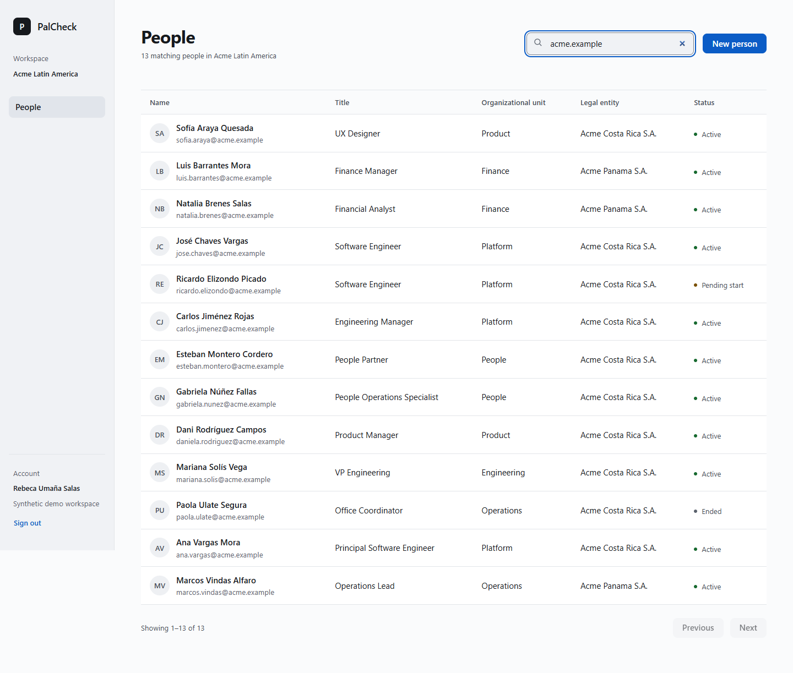
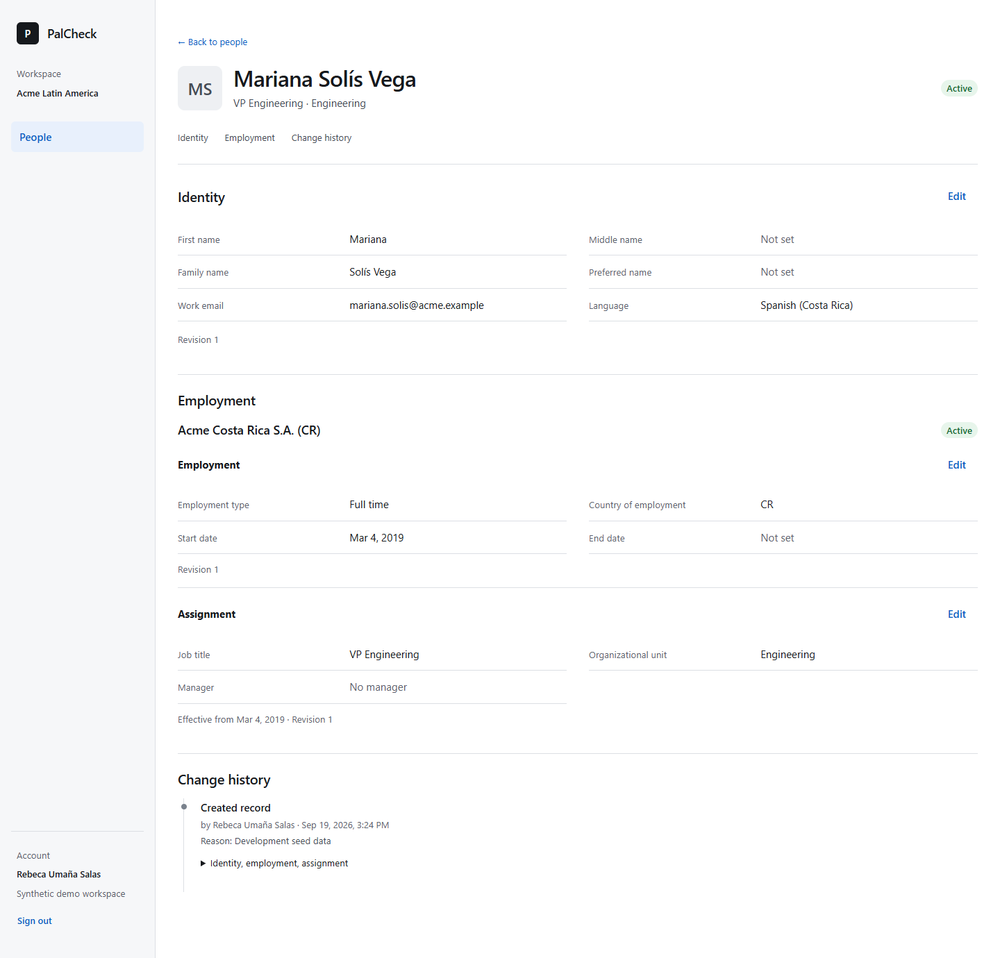

# PalCheck

**Workforce foundations for Latin America. Created by Daniel Aguilar.**

PalCheck is an independent workforce platform project, starting with Costa Rica. Its long-term purpose is to connect a clear workforce model with local HR concepts and downstream systems. Global HR abstractions do not always express Latin American concepts naturally; the design keeps domain concepts, researched legal rules, and software behavior separate.

**Current status: Phase 1 implemented and independently reviewed; awaiting Daniel's acceptance.** The working application is an authenticated, tenant-aware workforce directory with safe editing and change history. Localization policy execution and orchestration remain future work. See the [review and evidence](docs/PHASE_1_CODEX_REVIEW.md) and [implementation plan](docs/PHASE_1_IMPLEMENTATION_PLAN.md).

## What works today

- OIDC sign-in with a backend session, server-resolved tenant context, and administrator/viewer permissions.
- A paged People directory with accent-insensitive search: `Solis` finds `Solís`, preserving the actual spelling.
- Person records with identity, employment, assignment, and readable change history; create and edit synthetic records.
- Server-side manager search and paging, including multiple employments per person.
- Independent resource versions, deliberate conflict recovery, idempotent retries within a bounded receipt lifetime, and audit writes in the business transaction.
- A responsive native-control interface with light/dark themes, keyboard navigation, and automated accessibility checks.





[View the dark appearance](docs/screenshots/person-dark.png). All screenshot data is fictional.

## Architecture

One Java/Spring modular monolith and one React application. Packages separate `shared`, `platform`, `access`, `audit`, and `workforce`; ArchUnit checks their boundaries. Explicit JDBC queries and tenant-qualified foreign keys keep isolation visible. Transactions keep the workforce change, audit entry, and idempotency receipt together.

**Stack:** Java 17, Spring Boot 4, Spring Security OIDC, Spring JDBC, PostgreSQL 17, Flyway; React 19, TypeScript, Vite, TanStack Query, and `react-intl`. Keycloak is the development identity provider. Application/domain code remains provider-neutral. OAuth tokens are not exposed to application JavaScript; standard provider logout uses a browser redirect.

Read the [architecture](docs/ARCHITECTURE.md), [domain model](docs/DOMAIN_MODEL.md), [security controls and limits](docs/SECURITY.md), and [technical baseline ADR](docs/adr/0022-phase1-technical-baseline.md).

## Run locally

Use JDK 17+, Node 24, and PostgreSQL 17 plus Keycloak. The [local-development guide](docs/LOCAL_DEVELOPMENT.md) covers demo users, environment variables, Windows commands, the verified non-Docker setup, and troubleshooting.

From the repository root:

```bash
cp .env.example .env
docker compose up -d
```

In a terminal starting at the repository root:

```bash
cd backend
./mvnw spring-boot:run -Dspring-boot.run.profiles=dev
```

In another terminal starting at the repository root:

```bash
cd web
npm ci
npm run dev
```

Open **http://localhost:5173**. The guide provides development-only placeholder credentials. Never use real workforce data or credentials in this setup.

**Verification limit:** Docker is unavailable on the review machine, so Compose has not been executed. The complete application and browser suite were verified with local PostgreSQL 17 and an unpacked Keycloak distribution. PostgreSQL must supply the bundled `unaccent` extension; see the guide before using an existing database.

## Verify

Run each command from the indicated directory:

| Directory | Command | Purpose |
|---|---|---|
| `backend` | `./mvnw clean verify` | Unit, architecture, and integration tests using real embedded PostgreSQL; no Docker needed |
| `web` | `npm run typecheck && npm run lint && npm test && npm run build` | Types, lint, component/accessibility tests, and production build |
| `web` | `npx playwright install chromium` then `npm run e2e` | Browser journeys against the running full stack |
| `web` | `npm audit --audit-level=high` | npm dependency advisories |

The review passed **155 backend tests, 94 frontend tests, and 15 Chrome browser tests**, plus typecheck, lint, and production build. Tests cover tenant/permission denial, transaction rollback on audit failure, concurrent writes, duplicate requests, search, keyboard navigation, and browser axe checks. Human screen-reader testing and other browsers remain unverified.

Build, browser, dependency-review, npm-audit, and secret-scan workflows are prepared under [.github/workflows](.github/workflows/). They have not run on GitHub. Hosted security settings and the Java dependency graph still require verification; this is not a production-readiness claim.

## Planned, not implemented

Future milestones may add provider adapters, workforce-event orchestration, and researched country policy packs. Phase 1 has no HRIS connector or simulator, broker, outbox dispatcher, payroll, legal calculations, provisioning, or operations console. Daniel opens each milestone explicitly. See the [roadmap](docs/ROADMAP.md), [integration design](docs/INTEGRATION_ARCHITECTURE.md), and [localization research policy](docs/localization/costa-rica/LEGAL_RESEARCH_POLICY.md).

## Project documentation

| Topic | Start here |
|---|---|
| Product and scope | [Product vision](docs/PRODUCT_VISION.md), [master brief](MASTER_PROJECT_BRIEF.md) |
| Engineering decisions | [ADRs](docs/adr/README.md), [architecture review](docs/CODEX_ARCHITECTURE_REVIEW.md) |
| Product design | [UI system](docs/UI_SYSTEM.md) |
| Phase 1 review and next prompt | [Codex review](docs/PHASE_1_CODEX_REVIEW.md), [review handoff](docs/PHASE_1_REVIEW_HANDOFF.md) |
| AI-assisted engineering history | [Agent rules](AGENTS.md), [collaboration](docs/AI_COLLABORATION.md), [worklog](docs/WORKLOG.md) |

## Ownership and independence

Copyright © 2026 Daniel Aguilar. PalCheck was created by Daniel Aguilar; AI assistance and engineering decisions are documented openly. The source is publicly available at [d4guilar/palcheck](https://github.com/d4guilar/palcheck). **No open-source license has been selected or granted for PalCheck.** See [COPYRIGHT.md](COPYRIGHT.md) and the [open-source decision](docs/OPEN_SOURCE_STRATEGY.md); third-party notices remain their own.

PalCheck is not affiliated with, endorsed by, or certified by Apple, Microsoft, Workday, Equifax, SAP, Oracle, ServiceNow, or any other employer or vendor. The UI uses native system fonts and independent styling, without proprietary Apple assets. Legal concepts remain `UNVERIFIED` until researched under the project policy; no legal rules are implemented. Project documentation is not legal advice.
