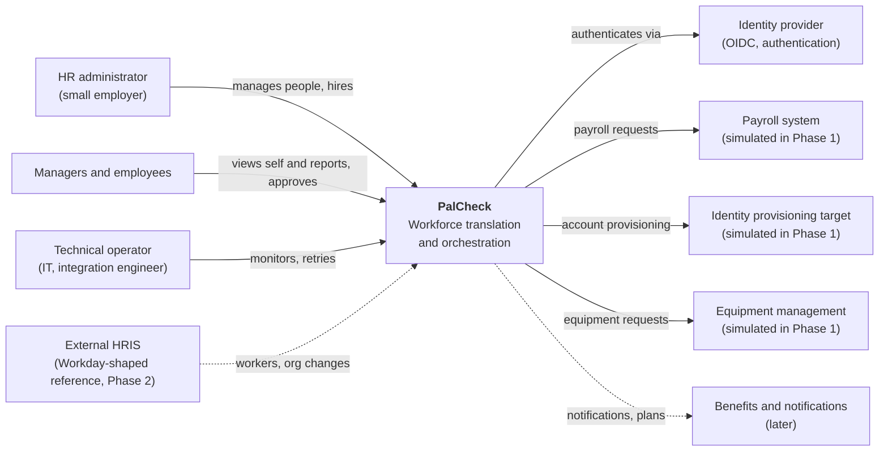

# 01. System Context

Who and what PalCheck talks to. Phase 1 shows solid lines; dashed lines arrive later.

**How to read this.** PalCheck is the system of record in standalone mode (primary). In overlay mode (Phase 2+), the external HRIS becomes the owner of some fields and PalCheck consumes and enriches its data
([ADR-0017](../adr/0017-primary-product-mode.md)). Every system except the identity provider is *simulated* in Phase 1 and is labelled so in the product.

Related: [ARCHITECTURE.md](../ARCHITECTURE.md), [02 container diagram](02-container.md).
