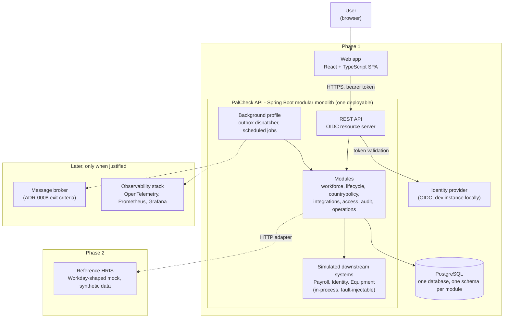

# 02. Containers

Deployable units and data stores. One application process holds every module; background work is a profile of the same artifact, not a separate service.

**How to read this.** Dashed lines and the *Phase 2* and *Later* groups are not built yet. There is no broker until [ADR-0008](../adr/0008-broker-none-yet.md)'s exit criteria are met. The background profile can be split into its own process
without code changes when a reason appears ([ARCHITECTURE.md](../ARCHITECTURE.md) section 10).

Related: [01 system context](01-system-context.md), [03 module map](03-module-map.md).
