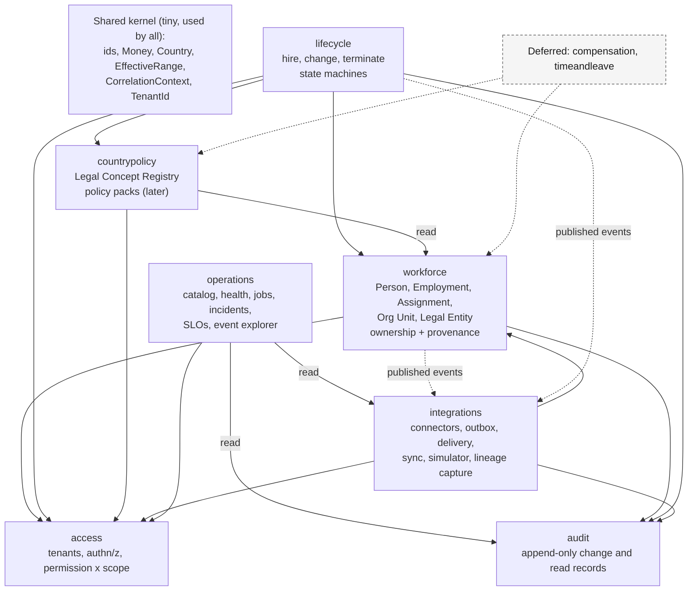
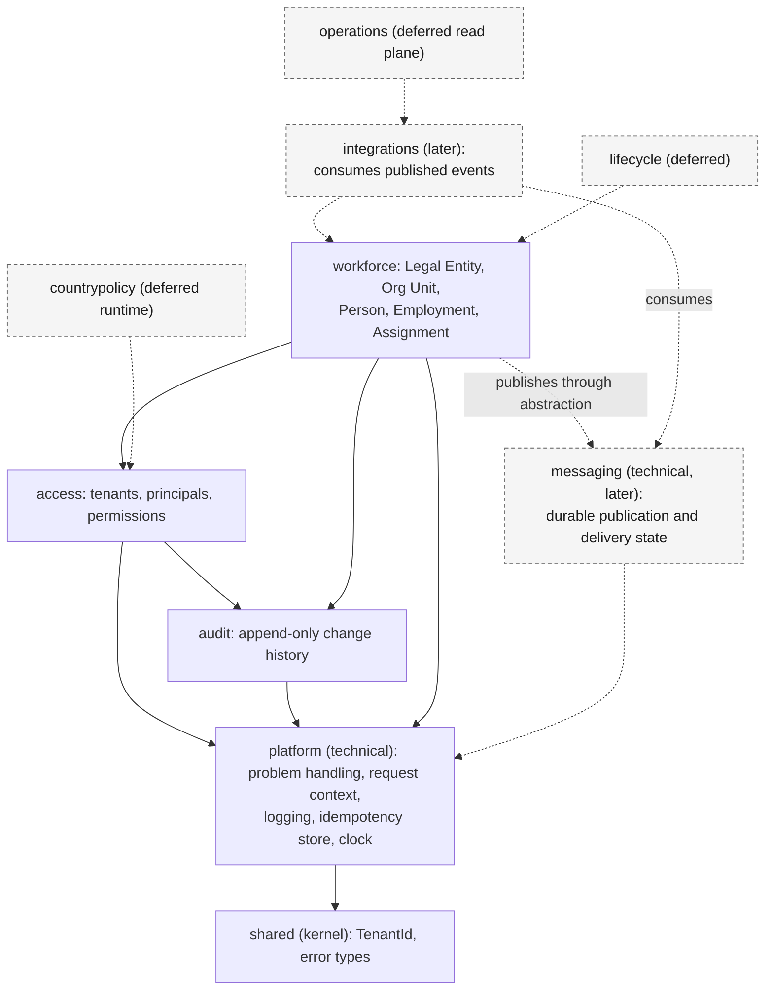

# 03. Modules and Bounded Contexts

> **Reconciliation notice (2026-09-19):** the diagram below is the **original Phase 0 proposal**. It is superseded in part by the accepted dependency direction in [MODULES.md](../MODULES.md) section 2a and the diagram at the end of this file: durable publication is technical `messaging` infrastructure (not owned by `integrations`); `lifecycle` and `operations` are deferred; Phase 1 builds `access`, `audit` and `workforce` only.

Allowed dependencies between modules. Solid arrow = calls the target's public API. Dashed arrow = reacts to published events (no code dependency). The graph is acyclic.

**How to read this.** `workforce` never depends on `integrations`, `lifecycle`, or `countrypolicy`; it emits events and they react. `access` and `audit` depend on nothing but the shared kernel. Modules reference each other by ID only (no cross-module foreign
keys or joins), which is what keeps extraction possible. `integrations` is the first extraction candidate. Full specification: [MODULES.md](../MODULES.md).

Authorization without a cycle: `access` evaluates grants; the owning module supplies the "is this record in scope?" check ([ADR-0014](../adr/0014-authorization.md)).

## Accepted dependency direction (2026-09-19)

Phase 1 packages are solid; later packages are dashed. `messaging` is technical infrastructure and depends on no domain module. `integrations` consumes published events and does not own the infrastructure that domain modules publish through.

`audit` never depends on `access` or `workforce`. Solid arrows are Phase 1 code dependencies.
