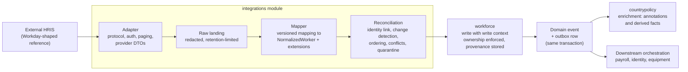
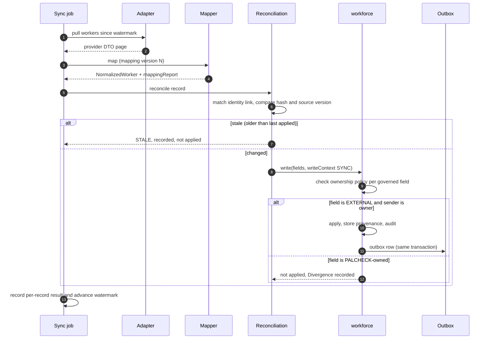

# 04. External HRIS Integration

The inbound translation pipeline (Phase 2). Provider vocabulary exists only inside the adapter; everything to the right of the mapper speaks PalCheck's contract.

## Pipeline

## One delta sync, with the ownership decision

**How to read this.** Nothing skips a stage. A record that cannot be applied safely is *quarantined* with its reason, never silently dropped or force-applied. Unmapped provider data is preserved in `extensions` and reported in the mapping report. Policy enrichment and downstream
orchestration react to the *event*, so they behave identically whether a change came from a PalCheck user or from a sync.

Details: [INTEGRATION_ARCHITECTURE.md](../INTEGRATION_ARCHITECTURE.md), [DATA_OWNERSHIP_AND_LINEAGE.md](../DATA_OWNERSHIP_AND_LINEAGE.md), [ADR-0004](../adr/0004-hris-adapter-boundary.md).
