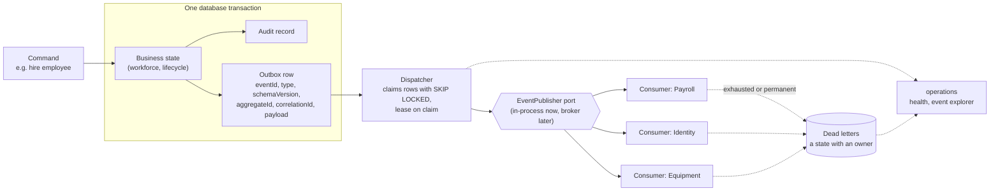
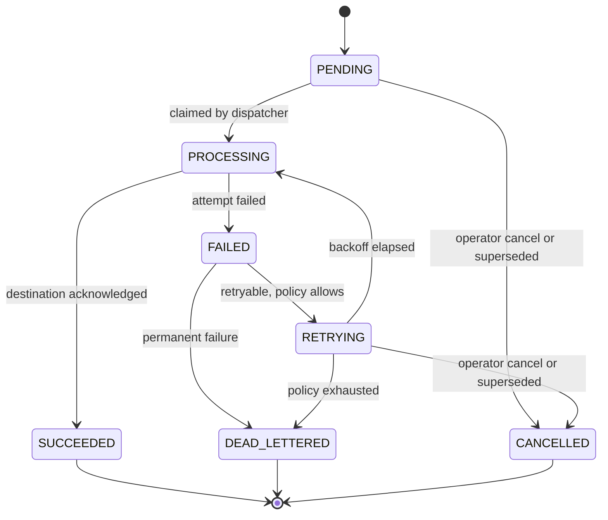
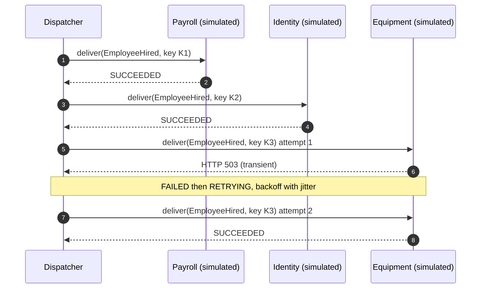
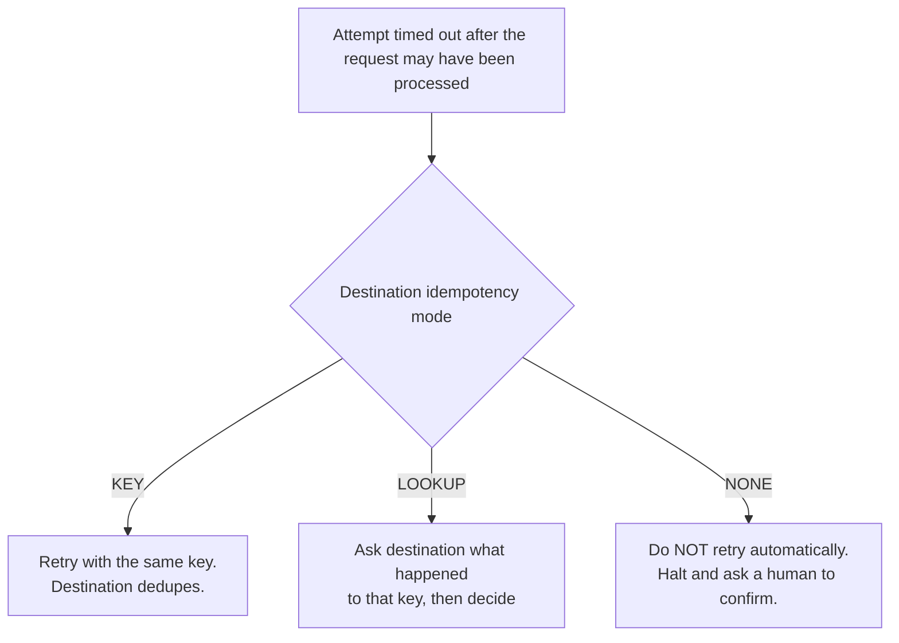

# 05. Event Processing

> **Reconciliation notice (2026-09-19):** this diagram is the original Phase 0 proposal. Outbox ownership is amended (technical `messaging`, not `integrations`), event-ID-only idempotency is amended (business operation identity, [ADR-0019](../adr/0019-durable-delivery-and-effect-identity.md)), and the attempt lifecycle lacks the `RECONCILING` / `MANUAL_REVIEW` states shown in [diagram 09](09-proposed-transaction-and-delivery.md). **Nothing here is Phase 1 scope.**

Outbox to delivery, the attempt lifecycle, and the reference resilience scenario. No broker in Phase 1 ([ADR-0008](../adr/0008-broker-none-yet.md)); the publisher is behind a port.

## Flow

## Delivery attempt lifecycle

## Reference scenario: `EmployeeHired`

Payroll and Identity succeed; Equipment fails once, then recovers. Every attempt carries the same correlation ID; each retry reuses the same idempotency key.

## The dangerous case: unknown outcome

**How to read this.** The business change and its outbox row commit together, so a crash between them cannot lose or invent an event. Delivery is at-least-once; safety comes from idempotent processing, not from a claim of exactly-once. Retry, replay, and reprocess are
distinct operations ([INTEGRATION_ARCHITECTURE.md](../INTEGRATION_ARCHITECTURE.md) 6.4). Decisions: [ADR-0006](../adr/0006-event-driven-integration.md), [ADR-0007](../adr/0007-transactional-outbox.md).
