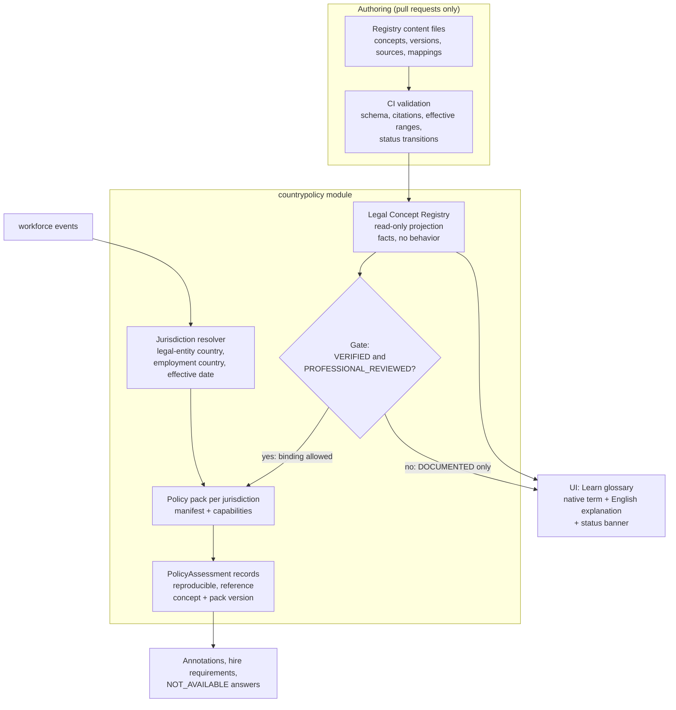
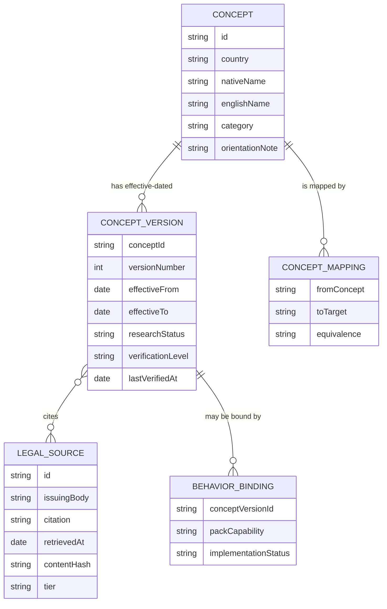

# 06. Country Policy Architecture

Where local knowledge lives, how it gets there, and the gate between facts and behavior. **No legal content appears in these diagrams.**

## Content to behavior

## Registry entities

**How to read this.** The three layers are separate entities with separate gates: `CONCEPT` is the domain description, `CONCEPT_VERSION` holds what the law says (once verified), `BEHAVIOR_BINDING` is what PalCheck does. Software can attach behavior only through a binding to a
verified and professionally reviewed version. `CONCEPT_MAPPING.equivalence` is `EXACT`, `PARTIAL`, `NONE`, or `UNKNOWN`; `UNKNOWN` (the default) blocks automatic translation.

Details: [COUNTRY_POLICY_ARCHITECTURE.md](../localization/COUNTRY_POLICY_ARCHITECTURE.md), [LEGAL_CONCEPT_REGISTRY.md](../localization/LEGAL_CONCEPT_REGISTRY.md), [ADR-0011](../adr/0011-country-policy-architecture.md), [ADR-0012](../adr/0012-legal-concept-registry.md).
