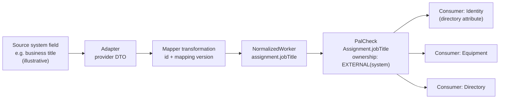
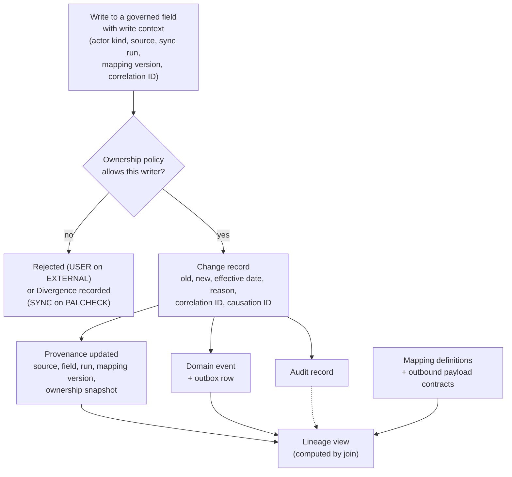
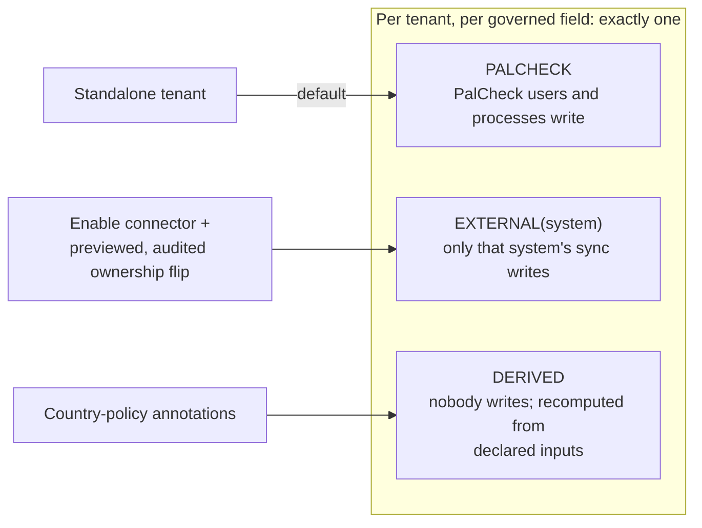

# 07. Data Lineage and Ownership

The lineage chain from the brief, the single capture point that feeds it, and the ownership check on every write. The provider field name is illustrative.

## Field lineage (what a technical user can inspect)

Shown to the user: source system, source field, transformation, destination field, mapping version, last sync, downstream consumers, correlation ID. Values are not shown by default.

## Single capture point

## Ownership modes per governed field

**How to read this.** Ownership *policy* (who may write), *provenance* (where the value came from), *audit* (who changed it), and the *event* (what others should react to) are four different records made from **one** change record in **one** transaction. The lineage view is a
join over them plus mapping definitions and payload contracts; no per-value lineage table is stored. The ownership flip on connector enablement is the test of the standalone-first decision ([ADR-0017](../adr/0017-primary-product-mode.md)).

Details: [DATA_OWNERSHIP_AND_LINEAGE.md](../DATA_OWNERSHIP_AND_LINEAGE.md), [ADR-0005](../adr/0005-source-of-truth-ownership.md), [ADR-0015](../adr/0015-data-lineage.md).
