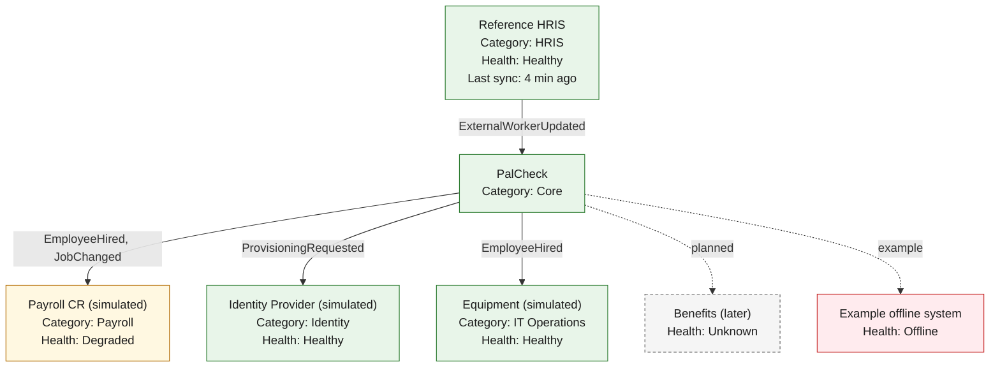

# 08. Enterprise Systems Topology

The operations view of connected systems, with the health states the console can show. The example statuses below are **illustrative** (borrowed from the brief), not fixed content. In the product the graph is derived from the connector registry and observed flows,
and always has a table equivalent.

## Table equivalent (the accessible form)

| System | Category | Simulated | Direction | Event types | Health | Reason | Last successful interaction |
|---|---|---|---|---|---|---|---|
| Reference HRIS | HRIS | yes | inbound | ExternalWorkerUpdated | Healthy | Recent syncs succeeded | 4 min ago |
| Payroll CR | Payroll | yes | outbound | EmployeeHired, JobChanged | Degraded | Several recent attempts failed (retrying) | *(example)* |
| Identity Provider | Identity | yes | outbound | ProvisioningRequested | Healthy | Recent attempts succeeded | *(example)* |
| Equipment | IT Operations | yes | outbound | EmployeeHired | Healthy | Recent attempts succeeded | *(example)* |
| Benefits | Benefits | yes | outbound (planned) | none yet | Unknown | No data | never |

## Health states

| State | Meaning | Never means |
|---|---|---|
| Healthy | Recent signals within thresholds | "No data" |
| Degraded | Some signals outside thresholds; still working, possibly slowly or with retries | Down |
| Offline | Sustained failure or failed probes | A single failed attempt |
| Unknown | Too little recent data to judge | Healthy |

**How to read this.** Color is a redundant cue: every state has a text label and icon. Thresholds and windows are configuration chosen in Phase 1 from real delivery data. Simulated systems carry a *Simulated* label in the product. Details: [ENTERPRISE_SYSTEMS.md](../ENTERPRISE_SYSTEMS.md),
[ADR-0016](../adr/0016-operations-model.md).
