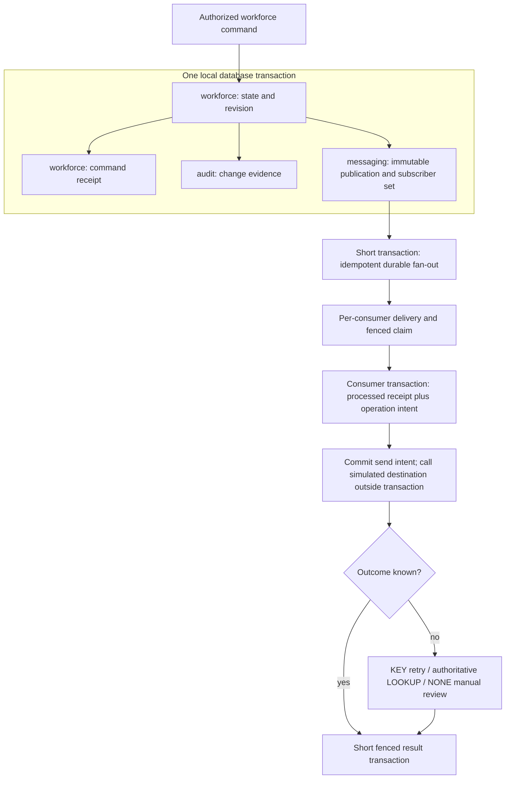
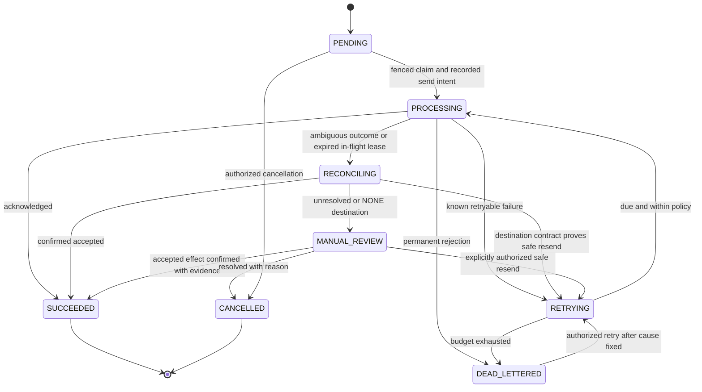

# 09. Proposed Transaction and Delivery Boundaries

Status: Proposed by CODEX, 2026-09-19; **accepted in part by Daniel the same day** (atomic state + audit + durable publication participation, technical `messaging` ownership, business operation identity, explicit failure recovery). Only state + audit is implemented in Phase 1. Supplements the original diagrams; see [ADR-0018](../adr/0018-module-transactions-and-persistence.md) and [ADR-0019](../adr/0019-durable-delivery-and-effect-identity.md). Messaging/integrations arrive with provisioning, after the proposed foundation.

Public APIs preserve ownership while participating in the same transaction; they do not permit another module to write private tables. `messaging` does not depend on workforce or integrations. Consumer event contracts are real declared dependencies. Frozen destination requests and operation identity survive retries and event-version changes.

State names describe delivery software behavior, not research/implementation statuses. Attempts are append-oriented records under the operation; reusing an operation does not rewrite previous attempts. Local fencing cannot revoke a request already executing remotely. Full protocol and failure tests: [review §8](../CODEX_ARCHITECTURE_REVIEW.md#8-event-architecture-outbox-and-idempotency).

Validation: reviewed as text; Mermaid rendering remains **Unverified:** until a renderer is available. No dependency was installed during Phase 0.
